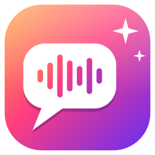
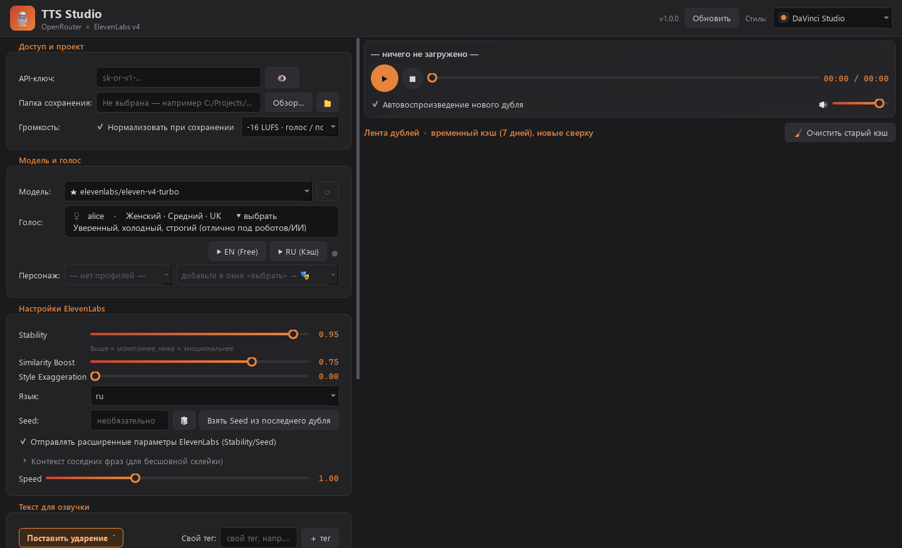

<div align="center">



# TTS Studio

Настольная студия озвучки для Windows: голоса ElevenLabs через OpenRouter, дубли, персонажи, нормализация громкости и перетаскивание в DaVinci Resolve.

**[Сайт](https://freesize83.github.io/tts-studio/)** · **[Скачать .exe](https://github.com/FreeSize83/tts-studio/releases/latest/download/TTS-Studio.exe)**

</div>



## Как начать

1. Скачайте `TTS-Studio.exe` и запустите откуда удобно. Папки для озвучки и кэша выбираются в настройках.
2. Введите API-ключ [OpenRouter](https://openrouter.ai/keys).
3. Выберите голос, напишите текст и нажмите `Ctrl + Enter`.

Вкладка «Локальная · VoxCPM» запускает модель [VoxCPM](https://github.com/OpenBMB/VoxCPM) (Apache-2.0) на вашем компьютере: дизайн и клонирование голоса без ключей. Установка модели запускается кнопкой на вкладке.

Чтобы обновиться, нажмите «Обновить» в программе: она сама заменит файл и перезапустится.

## Запуск из исходников

Нужен Python 3.10 или новее. Запустите `run.bat`: он создаст окружение и установит зависимости.

## Выпуск новой версии

1. Поменяйте `APP_VERSION` в `tts_studio.py`.
2. Закоммитьте и отправьте тег с тем же номером:

```bash
git tag v1.0.1
```

```bash
git push origin main v1.0.1
```

GitHub Actions соберёт exe и опубликует релиз, после чего кнопка «Обновить» у пользователей подхватит новую версию.

> `config.json` хранит API-ключ в открытом виде и не должен попадать в репозиторий: он указан в `.gitignore`.
